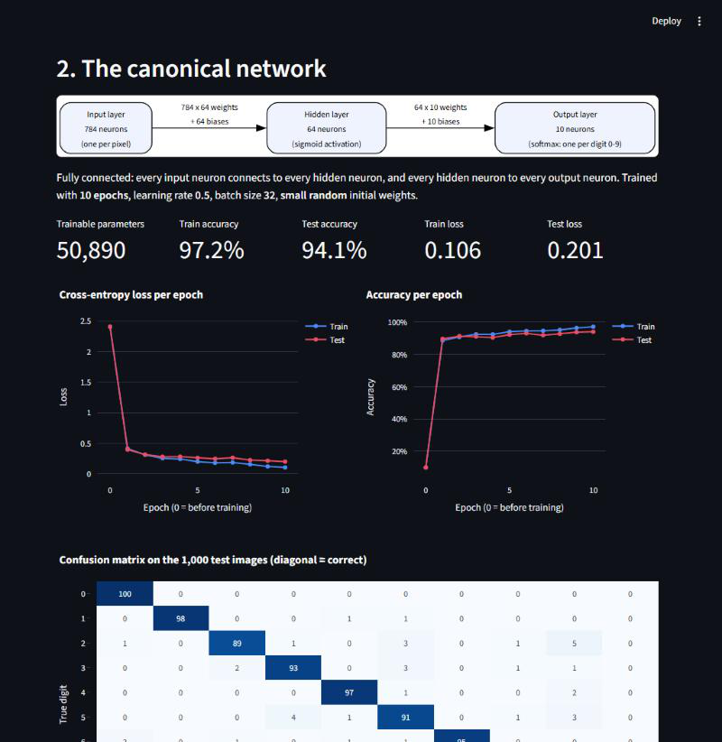
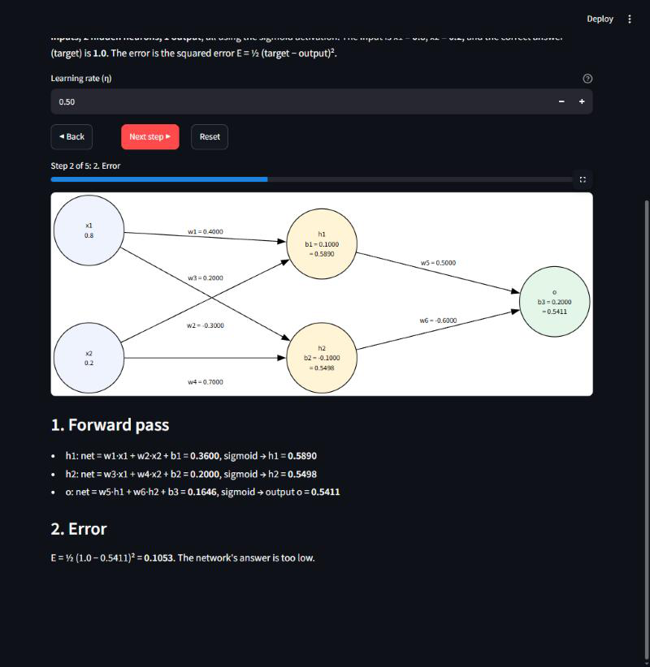
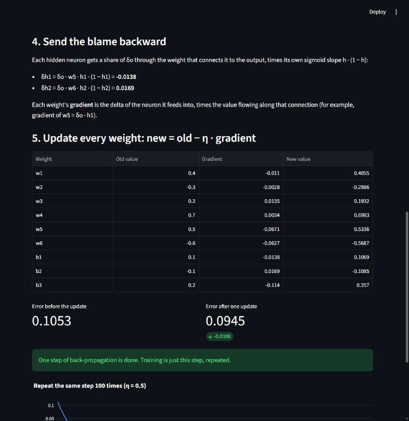
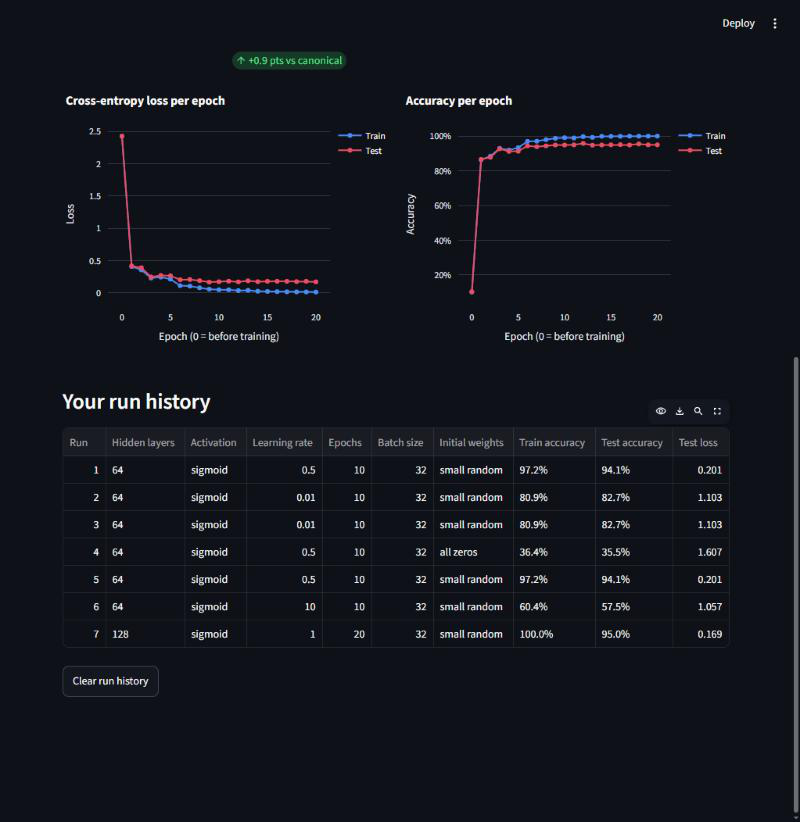
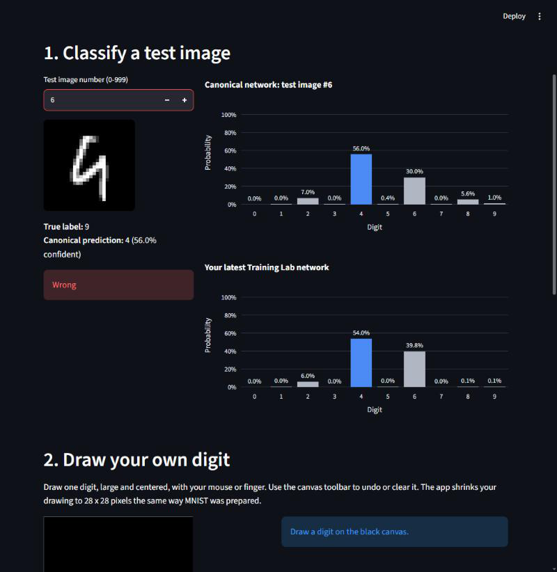
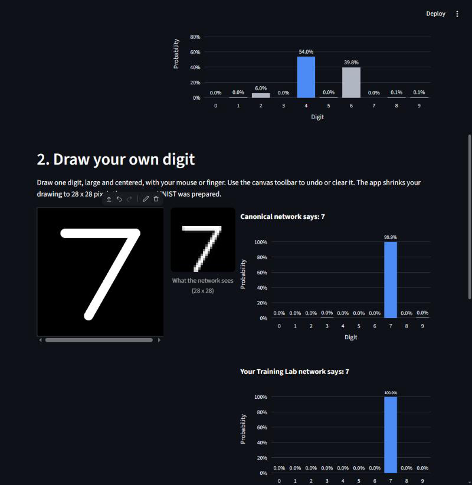
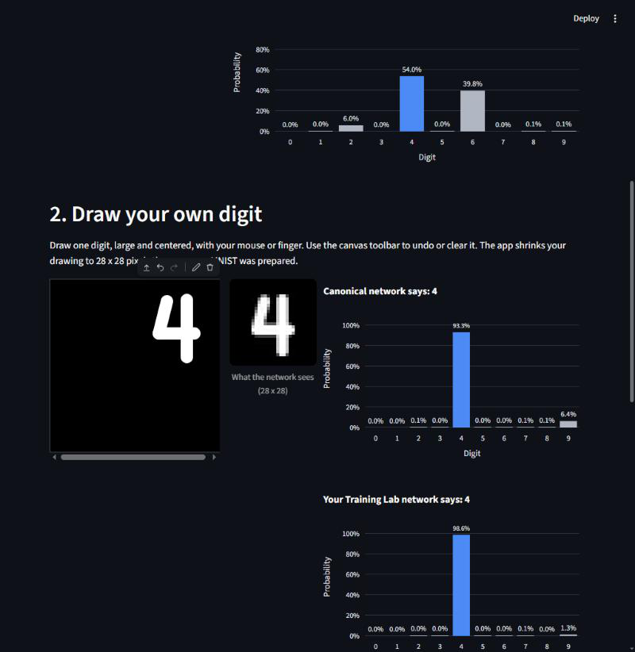

# Activity 15 — Reflection Questions: Digit Lab

**Student:** Diego Kamil Olea Ruiz
**Course:** Introduction to Artificial Intelligence — Universidad Anáhuac Mayab
**Sessions:** 25–27 · Neural networks, back-propagation and applications

All numbers come from the **canonical network** and the app's default values, unless a question asks
about my own Training Lab runs or drawings.

---

## Part A — Representation (Session 25)

### 1. Layer sizes

- Input layer: **784** neurons
- Hidden layer: **64** neurons (sigmoid)
- Output layer: **10** neurons (softmax)

The input has 784 neurons because every image is 28 × 28 pixels, and 28 × 28 = 784: one neuron per
pixel, holding its brightness from 0 to 1. The output has exactly 10 because there are 10 possible
answers, the digits 0 to 9; each output neuron gives the probability of one digit and the softmax
makes the 10 add up to 100%.

### 2. Trainable parameters

**50,890** trainable parameters.

- Input → hidden: 784 × 64 = 50,176 weights + 64 biases = 50,240
- Hidden → output: 64 × 10 = 640 weights + 10 biases = 650
- Total: 50,240 + 650 = **50,890**

### 3. Canonical accuracy and loss

- Train accuracy: **97.2%**
- Test accuracy: **94.1%**
- Train loss: **0.106**
- Test loss: **0.201**

It is a little better on the images it trained on than on new ones (a 3.1-point gap), but 94.1% on
1,000 digits it never saw is solid for such a small network.

### 4. One hidden neuron

I picked **neuron 36**. It has a red arc on the top and another on the bottom, with a blue band
across the middle. So it fires when there is ink around the outside of the digit and stays quiet when
ink crosses the center: it looks like a detector for a round loop with an empty middle, like a **0**,
and it would be "punished" by the middle bar of an 8 or a 3. Nobody drew that pattern. It came from
**back-propagation**: the 784 weights started as small random numbers, and after thousands of small
updates on the 6,000 training images, the weights that helped reduce the error grew and the others
shrank, until this shape appeared on its own.

---

## Part B — Back-propagation (Session 26)

### 5. Back-propagation numbers (learning rate 0.50)

- (a) Output before the update: **o = 0.5411**
- (b) Error before the update: **E = 0.1053**
- (c) New weight: **w5 = 0.5336** (it was 0.5)
- (d) Error after one update: **0.0945**

### 6. The backward pass

In step 1 the information goes forward (x → h → o). In steps 3 and 4 it goes the other way: the
algorithm starts from the mistake at the output and sends it back toward the inputs, which is why
it's called *back*-propagation.

First it measures how much the output neuron is to blame: **δo = −0.1140**. It is negative because
the answer (0.5411) was too low compared with the target (1.0). Then that blame is split between the
hidden neurons through the weights that connect them to the output, times each one's sigmoid slope:
**δh1 = δo · w5 · h1(1 − h1) = −0.0138** and **δh2 = δo · w6 · h2(1 − h2) = 0.0169**. h2 gets the
opposite sign because w6 is negative (−0.6): raising h2 would actually lower the output.

Each weight's gradient is the delta of the neuron it feeds into times the value flowing through it,
for example gradient of w5 = δo · h1 = −0.0671. The update is new = old − η · gradient, so a
negative gradient makes the weight go up (w5: 0.5 → 0.5336) and a positive one makes it go down
(w6's gradient was also negative, so w6 went from −0.6 to −0.5687). After that one step the error
dropped from 0.1053 to 0.0945.

### 7. Run-history table

My runs (all 64 hidden sigmoid, batch 32, unless stated):

- Run 1, **defaults** (η = 0.5, 10 epochs, small random): train 97.2%, test 94.1%, test loss 0.201. Exactly the canonical network.
- Runs 2–3, **η = 0.01 (too low)**: train 80.9%, test 82.7%, test loss 1.103.
- Run 4, **all zeros** initial weights (η = 0.5): train 36.4%, test 35.5%, test loss 1.607.
- Run 5, defaults again: same 94.1% (it is deterministic).
- Run 6, **η = 10 (too high)**: train 60.4%, test 57.5%, test loss 1.057.
- Run 7, **128 hidden, η = 1.0, 20 epochs**: train 100.0%, test 95.0%, test loss 0.169.

**Too low (0.01):** the loss curve goes down slowly and smoothly and is still dropping at epoch 10,
and test accuracy keeps climbing (48.5% after epoch 1, 82.7% at the end). Each update is so small
that 10 epochs aren't enough to get anywhere near the canonical 94%; it never "finished" learning.

**Too high (10):** the curves jump around instead of going down. Test accuracy went 25% → 55% → 63%
and then back down to 57.5% at the end. The steps are so big that each update overshoots the
minimum and undoes part of what the previous one learned, so the network bounces instead of
settling.

### 8. All-zeros initial weights

With all zeros the network only reached **35.5%** test accuracy (36.4% train, test loss 1.607), versus
94.1% with small random weights and the same settings.

If every weight starts at the same value, every hidden neuron computes exactly the same thing on
every image: same input, same weights, same output. Then back-propagation gives all of them the same
delta and the same gradient, so they get the same update and stay identical forever. Instead of 64
different feature detectors, the network effectively has one copied 64 times, so it can't learn the
many different strokes it needs. Random starting weights break that symmetry.

### 9. Best configuration

My best test accuracy was **95.0%**, with **1 hidden layer of 128 neurons, sigmoid, η = 1.0,
20 epochs, batch 32, small random weights** (run 7), 0.9 points above the canonical network.

Bigger and longer helped a little, but not for free. The train − test gap grew from **3.1 points**
(canonical: 97.2% vs 94.1%) to **5.0 points** (run 7: 100.0% vs 95.0%). The bigger network memorized
the 6,000 training images perfectly, but only gained 0.9 points on new images. More neurons and more
epochs mostly make the network fit its training set better, and past a point that turns into
overfitting rather than better recognition, so they don't *always* improve test accuracy.

---

## Part C — Applications (Session 27)

### 10. Test images and mistakes

- Image **#24**: true label **7**, prediction **7**, confidence **100.0%**. Correct.
- Image **#4**: true label **4**, prediction **4**, confidence **85.9%**. Correct.
- Image **#6**: true label **9**, prediction **4**, confidence **56.0%**. Wrong.

The canonical network misclassifies **59 of the 1,000** test images (that is the 94.1% accuracy).
Image #6 is a 9 with an open top, so it really looks like a 4; the network's second choice was 6
(30.0%), and it was only 56% sure.

### 11. My own drawings

- A large, centered **7** → the network said **7** (99.9%).
- A single vertical stroke **1** → it said **1** (96.8%).
- A small **4** drawn in the top-right corner with straight, blocky strokes → it said **4** (93.3%), with 6.4% on 9.

All three were right, but the confidence went down as my drawing moved away from the MNIST style.
My strokes are perfectly even, thick and straight because they come from a mouse, while MNIST digits
were written with a pen and have curved, uneven strokes. The network only knows the 6,000 examples it
saw, so a 4 made of square lines is "unusual" for it, which is why some probability leaked to 9. The
app also re-centers and shrinks my drawing to 28 × 28 (you can see it in "What the network sees"),
which saved the off-center 4, but a drawing that is too thin or too small loses detail in that step.

### 12. Real-world application

**Medical diagnosis: detecting pneumonia in chest X-rays.**

- **Inputs:** the pixels of a chest X-ray, for example scaled down to 224 × 224 grayscale (about 50,000
  input neurons, the same idea as our 784), plus maybe the patient's age.
- **Outputs:** two softmax neurons, "pneumonia" and "normal", each with a probability, like our 10
  digits.
- **Risk of a wrong prediction:** the same thing that happened with image #6, a confident-looking
  answer that is wrong. If the network says "normal" at 56% for a patient who has pneumonia, the
  doctor could send them home without antibiotics and the infection could get much worse. That's why
  in medicine these networks are used as a second opinion, and low-confidence cases should always go
  to a radiologist.

---

## Declaration of AI use

I used an AI assistant (Claude) for this activity. Under my direction it ran the app locally on my
computer, operated it in the browser (training runs, test-image lookups, the canvas drawings) and took
the screenshots, computed and double-checked the canonical values with the activity's own code, and
helped me draft and polish the English of the answers. I reviewed every answer against the
screenshots, and all the numbers come from those runs.
